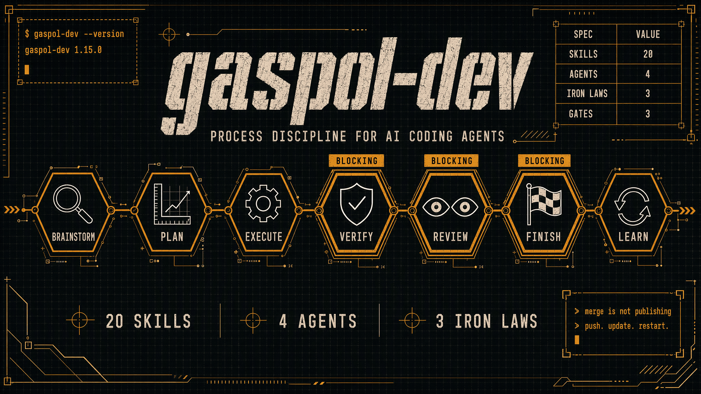

# gaspol-dev

**Process discipline for Claude Code — so AI writes code that is real, complete, and actually runs.**



[](https://github.com/alisadikinma/gaspol-dev) [](LICENSE) [](#the-17-skills-organized-by-workflow) [](#agents) [](#testing)

---

## Why gaspol?

You plan a feature carefully. Claude executes it. And then you find:

- A `const data = [...]` placeholder where a real API call should be
- Phase 3 completed "successfully" but 3 steps got skipped
- Tests written after implementation (or not at all)
- A new hook created, when an identical one already exists in the codebase
- A step reported as done that nothing ever checked
- A phase "verified" by a model *reading* the diff, while nothing ever ran `tsc`
- Five bugs reported in one message, turned into five separate tickets
- A backend change with nothing to review until the diff lands — too late to say "that's the wrong flow"
- Green tests, and an app that does not start

**gaspol-dev fixes this.** 17 skills + 4 agents that enforce process discipline, catch placeholders,
**run** the checks instead of reading the code, demand a reviewable design before any code, and gate
completion with evidence — a screenshot and an exit code, never an adjective.

---

## What makes it different

| Other plugins | gaspol-dev |
|---|---|
| Advisory rules ("write test first") | **Hard gates** — execute refuses to run a phase whose step 1 isn't a failing test |
| Code review at the end | **Tiered auto-review** per phase, sized by a complexity classifier |
| Plan-level fidelity check | **Step-level evidence-based** plan-verifier — a code quote per FOUND item, BLOCKING on any MISSING |
| Review findings taken at face value | **Adversarial refutation** — one refuter per Critical finding, defaulting to REFUTED, plus a 0–100 confidence rubric |
| "Done" is self-reported | **Evidence-gated** — sync-docs must show CLAUDE.md in the branch diff, not a ticked box |
| Merge = shipped | **Publication gate** — a local merge publishes nothing, and finish says so |
| Generic training-data suggestions | **Industry research grounding** with a freshness-aware cache (🟢🟡🟠🔴) |
| Single-project context | **Cross-project KB** — works offline out of the box, GitHub sync optional |
| Fixed model | **Auto-rubric model switching** per task type |
| Reinvents what the platform already ships | **Delegates** — design to `ui-ux-pro-max`, security to the CLI built-in |
| Autonomous = unsafe | **Autonomous with hard-stop guardrails** — 8 always-pause conditions |
| "Write the minimum that works" | **Completeness Ladder** — happy path → every error path → every edge case → the tests that prove them → observability. The only legitimate stop is genuinely unrelated work |
| N bugs reported → N tickets | **Batch Gate** — one report, one ticket. Splitting needs a listed reason and never exceeds two without asking |
| Backend work gets no design review | **Design Artifact gate (BLOCKING)** — logic-only work publishes a five-section artifact before execution starts |
| Checks run once, at the end | **Verification loop per phase** — baseline before Phase A, then L1 static → L2 unit → L3 build, fail-fast, before every checkpoint |
| "It compiles, so it works" | **Live App Check** — web through the Playwright MCP, mobile through `adb` on a real device or emulator. A check that did not run is never recorded as passed |

---

## Quick Start

```bash
claude plugin marketplace add alisadikinma/gaspol-one
claude plugin install gaspol-dev@gaspol-one
```

Restart Claude Code. That's it — the cross-project KB works out of the box (local-only, created on
first use; GitHub sync is an optional upgrade, never a requirement).

Start with `/gaspol-brainstorm` for any new feature idea. The chain takes over from there.

**Optional, and soft-referenced:** `claude plugin install ui-ux-pro-max@ui-ux-pro-max-skill` for
design intelligence. Missing it degrades design quality; nothing breaks.

---

## The finish chain: six steps, three of them block

This is the part most plugins don't have. When you say "I'm done", `gaspol-finish` runs six steps **in order**, and none of them is conditional on how the diff looks:

| # | Step | Blocking? |
|---|---|---|
| 1 | `gaspol-verify` — 4 layers (technical, plan fidelity, placeholder scan, integration) | — |
| 2 | `plan-verifier` agent — step-level, evidence-based, 3 random FOUND items spot-checked | **BLOCKS** |
| 3 | `gaspol-review` at Tier 1 — findings must survive adversarial refutation to count | **BLOCKS** on Critical |
| 4 | `/security-review` — the CLI built-in, on **every** branch | **BLOCKS** on any finding |
| 5 | `gaspol-sync-docs` — CLAUDE.md must appear in the branch diff, not just be claimed | — |
| 6 | `gaspol-learn` — quality-gated pattern capture to the KB | — |

Then the ledger is closed with a truthful cursor, other open ledgers are surfaced, and — because **merging is not publishing** — you're told to push, and for a plugin repo to run `claude plugin update <plugin>@<marketplace>` and restart.

Three of these gates exist because their absence caused a real, observed failure. Step 4 always runs because "this diff doesn't look security-sensitive" is a judgement call nobody should make under deadline. Step 5 demands evidence because a self-reported checkbox once shipped a release whose changelog never mentioned half of what was in it.

---

## What 1.20 – 1.24 changed, and why

Five releases in one stretch, each one repairing something that had been quietly broken. They are
worth reading together because they form a single argument: **instructions are the weakest lever,
and gaspol had been pulling it.**

### The default stance told the agent to do less (1.20.0)

v1.9 absorbed a "Laziness Ladder" as the always-on coding stance, injected into every session. Its
first rung asked *"does this need to exist at all?"* and its rules were *"fewest files possible,
shortest working diff wins."* The fidelity boundary held — no placeholders, no skipped tests — so
output stayed **real**. Nothing kept it **complete**, and shallow work breaches no boundary.

It is replaced by the **Completeness Ladder**: walk *down* and do every rung — happy path, every
error path that can actually happen, every edge case the input space allows (enumerate, don't
sample), the tests that prove them, the observability a 3am debugger needs, the one comment
explaining *why*. The only legitimate stop is genuinely unrelated work, flagged as separate scope.

A **Reuse Rule** survives from the old ladder, demoted from a scope rule to an implementation rule:
stdlib → native platform feature → already-installed dependency, and no interface with one
implementation. Reuse cuts cleverness, never coverage.

### One report, one ticket (1.20.0)

Five defects in one message used to mint five tickets. Nothing was counting, and the only adjacent
rule pushed the other way. The **Batch Gate** runs above the decompose gate in `gaspol-brainstorm`
*and* at the top of `gaspol-debug` — because bug reports route straight to debugging and never reach
brainstorm, so a rule living only in one of them would never fire for the case it was written for.

Default one ticket. Splitting needs a reason from a closed list, and the ceiling is two. Batching
changes the container, never the coverage: every item still becomes its own plan phase, ordered by
severity, with its own regression test.

### Logic-only work owes a design too (1.20.0)

`gaspol-brainstorm` used to offer `[No, pure backend/logic]`, and that branch skipped design
entirely. For a change that alters behaviour but not pixels, the first reviewable thing was the
diff — after it was built and tested.

`gaspol-plan` **Step 0** is now BLOCKING: every plan produces exactly one approved design artifact
before `gaspol-execute` will start. UI work renders a mockup; everything else publishes a
**Logic Design Artifact** — before/after behaviour with the current path *quoted from real code*, a
mermaid flow, a data-flow table, an edge-case matrix (empty = failed gate), and a blast-radius
statement. Three states: approved / pending / not published. *"Not applicable"* is deliberately not
one of them — that state **was** the defect.

### Three skills deleted, the rules inside them kept (1.21.0)

`gaspol-write-skill` (80K), `gaspol-kb-audit` (12K) and `gaspol-llm-test` (8K) are gone; 20 skills
became 17. Deleting a skill is easy — deleting the rules that happened to live inside it is the
risk. The **Prior-Art Gate** moved to `skills/_shared/prior-art-gate.md` and was generalised in the
move, KB promotion was repointed at a gate that actually exists, and the eval rule stayed inline in
`gaspol-plan` and `gaspol-verify`.

### The skill that runs on every job never ran anything (1.22.0)

```
grep -n "detect-stack|npm test|Validation Ladder" skills/gaspol-execute/SKILL.md   →  0 hits
```

`gaspol-execute` is the in-session execution path. Per phase it wrote a failing test, dispatched a
model to **read** the diff, and wrote a checkpoint. The Validation Ladder had existed since v1.8 —
but only in the subagent dispatch templates and `gaspol-parallel`. Every executable check was
deferred to `gaspol-verify` at the very end, which is the slowest and most expensive place to
discover a type error and far enough from its cause that fixing it becomes archaeology.

Now: a **verification baseline before Phase A** (a red baseline STOPS and asks, so a suite that was
already failing is never blamed on your first phase), then a **fail-fast ladder before every
checkpoint** — L1 static → L2 unit → L3 build. The failing command's output goes into the fix
**verbatim**, and the ladder re-runs from the failed level. **A phase may not be ticked until its
ladder ran.** It is the TDD gate's mirror: TDD refuses a phase with no failing test *before*, this
refuses one with no passing run *after*.

### The Live App Check had no machine (1.23.0)

`gaspol-verify` had carried *"invoke the `run` skill to actually launch the app and observe the
feature live"* since v1.14 — an instruction with nothing behind it. Everything else gaspol verifies
is static, and **all of it can be true of an app that does not start.**

Two lanes, and the asymmetry is the design:

| Lane | Precondition | Can gaspol satisfy it? |
|---|---|---|
| **web** | an app serving a URL | **yes** — start it, wait *by condition* (never a fixed sleep), drive the surface that changed through the **Playwright MCP**, capture a screenshot, the console, and failed requests |
| **android / ios / flutter** | a device over **USB debugging**, or a booted emulator | **no.** gaspol cannot plug in a phone. It probes, *offers* to boot a simulator, and asks |

`adb devices` has **four** meaningful outcomes, not two — `device`, **`unauthorized`** (plugged in,
RSA prompt not accepted), `offline`, and nothing. Answering `unauthorized` with "please connect a
device" tells you to plug in a phone you already plugged in.

Finding `adb` is itself a defect class: `command -v adb` returns nothing on a normal macOS setup
where Android Studio installed it to `~/Library/Android/sdk/platform-tools/` and never touched PATH.
Resolution order is `$ADB` → PATH → `$ANDROID_HOME` → `$ANDROID_SDK_ROOT` → the macOS and Linux
defaults. **A detector that is wrong in the common case is worse than no detector, because its
wrongness looks like a finding.**

**The rule that outranks the rest:** a check that did not run is recorded as **not run**, never as
passed — the rule `gaspol-finish` already applies to an unavailable `/security-review`. A lane that
could not run and got summarised as "verified" leaves the gate worse than useless, because now
somebody believes it was checked.

### The honest boundary

This confirms the app runs, the screen appears, the console is clean and requests succeed. It does
**not** confirm that what appeared matches the design — the screenshot is captured and attached for
a human; nothing compares it automatically. And there is still no eval harness proving these
changes make the *output* better. Both gaps are named here rather than papered over.

### Two gates that advised, and nobody enforced (1.24.0)

The previous release's closing note named the next two items in order of leverage. Both close here:

```
grep -rn regression skills/gaspol-verify skills/gaspol-finish   →  0 hits
```

`gaspol-debug` Phase 4 step 1 said *"Create a failing test case **(if possible)**"* — a default
nobody had to defend, and nothing downstream checked whether the possibility was real. It's now a
three-state contract with no silent default: `regression-test: <path>::<name> — RED at <sha>, GREEN
after fix` (written), `N/A — <reason>` (genuinely not testable), or `not run — <reason>` (a decision
with a name on it, not an excuse). `skills/gaspol-debug/scripts/regression-gate` checks it
deterministically — fix-commit detection reuses `git-history-reviewer.md`'s exact keyword set, so
the two cannot disagree — and is wired into both `gaspol-verify` Layer 1 and `gaspol-finish` Step 0,
before any agent is dispatched.

The second gap was the wrong-**layout** half of "the screenshot doesn't match the mockup" —
`design_audit.py` already covers wrong-colour and wrong-font. `skills/gaspol-verify/scripts/
geometry-diff` diffs two DOM geometry snapshots per `data-vv` marker: colour normalises across
hex/`rgb()`-comma/`rgb()`-space to one value, a missing marker BLOCKS while an extra one only WARNs,
and width/horizontal-position get a **ratio-of-viewport fallback** — an element at ~44% of two
different browser widths passes despite a 30px absolute gap, while the same element at 44% vs 61%
at *one* viewport still BLOCKS. The extractor (`--emit-extractor`) is a fixed JS literal, never
constructed from an argument — checked first in `main()`, before anything else is read, so a
hostile flag cannot reach what the caller executes. `skills/_shared/visual-contract.md` states the
canvas format once (`data-vv="<screen>.<element>"`, markup in the target stack, realistic
worst-case content, the file's path convention) and names precisely what IDS-6 Part B still leaves
open — the machine had to exist before the process depending on it was worth changing.

A genuine, reproducible bug turned up while chasing an *intermittent* suite failure, not a flaky
test: `has_fix_commit()` piped `git log | grep -qiE` directly. Under `set -o pipefail`, `grep -q`
exiting the instant it matches can `SIGPIPE` `git log` before it finishes writing, and pipefail then
reports the *pipeline's* exit status as `git log`'s non-zero SIGPIPE code — turning a real fix
commit into a false "not applicable" roughly one run in six. A 30-iteration standalone repro
isolated it to plain shell before the fix touched a line of the script; capturing `git log`'s output
into a variable before `grep` ever sees it removed the race outright (60/60 clean after).

Still open: the rest of IDS-6 Part B (`gaspol-visual-verify` as a skill, the two-fidelity
brainstorm/plan restructure, the pixel-diff trigger), and the eval harness — now its own ticket
(IDS-15), scoped separately because it measures the plugin from `tests/` and returns a score rather
than a pass/fail verdict.

---

## The 17 skills (organized by workflow)

### Planning
- **gaspol-brainstorm** — CLAUDE.md-first + KB precedent query (Phase 0.5) + novelty assessment (Phase 1.5) + three-path classification (spike / bounded / architectural)
- **gaspol-plan** — Implementation plan with Data Integration Map + TDD step 1 mandatory + per-phase verification + creates the ticket ledger
- **gaspol-research** — Deep-dive external libs/APIs with freshness-aware cache, quality gates, anti-hallucination spot-check
- **gaspol-adr** — Architecture Decision Records auto-captured at forks (MADR format, supersession + divergence support)

### Execution
- **gaspol-execute** — Per-phase checkpoints + TDD hard gate + tiered auto-review + plan-verifier BLOCKING
- **gaspol-worktree** — Isolated git worktree (native-tool-first, Step 0 detection + safety verification) so parallel work never collides
- **gaspol-parallel** — Multi-agent parallel (`mode: plan-phases` or `mode: independent-domains`) with worktree isolation, **DAG lane scheduling** (dependency waves + file-isolated lanes), and a per-task **Validation Ladder** (static→unit→build→integration→edge)
- **gaspol-auto** — Autonomous mode for a familiar codebase, with hard-stop guardrails on 8 conditions
- **gaspol-tdd** — RED-GREEN-REFACTOR, hard-gated by execute: no production code before a failing test
- **gaspol-debug** — Systematic root-cause debugging: no guessing, backward tracing, stop after 3 failed hypotheses

### Verification & Closure
- **gaspol-verify** — 4-layer verification; commands are **derived** from the project's stack markers, never hardcoded to npm
- **gaspol-review** — Tiered review lanes + adversarial refutation + 0–100 confidence rubric with an 80 threshold and an explicit false-positive catalogue
- **gaspol-receive-review** — Verify feedback before implementing it; no performative agreement, and push back when the reviewer is wrong
- **gaspol-finish** — The six-step chain above, plus ledger close and the publication gate

### Learning & Maintenance
- **gaspol-learn** — Quality-gated auto-capture post-finish (6 validation checks, user confirms)
- **gaspol-sync-docs** — CLAUDE.md sync (3 modes: post-implementation / audit / session learning)

### Bootstrap
- **using-gaspol** — Auto-trigger backbone: loaded at session start, enforces the 1% rule (invoke the matching skill BEFORE responding), routing table, instruction priority, and rationalization Red Flags

### Agents
- **code-reviewer** (Sonnet) — Quality review between commits
- **code-simplifier** (Haiku) — Refine for clarity without behaviour change
- **plan-verifier** (Opus) — **Step-level evidence-based** audit, BLOCKING verdict
- **spec-reviewer** (Opus) — Verify implementation matches spec exactly

---

## What gaspol deliberately does *not* own

A plugin that reimplements what the platform already ships is a fork waiting to drift. Two capabilities are delegated on purpose:

**Design intelligence → the [`ui-ux-pro-max`](https://github.com/nextlevelbuilder/ui-ux-pro-max-skill) plugin.** gaspol used to vendor a 1.4MB fork of its style, palette, and typography data. The fork drifted; upstream didn't. Install it with `claude plugin install ui-ux-pro-max@ui-ux-pro-max-skill`.

The reference is **soft — there is deliberately no `dependencies` key in `plugin.json`.** That field is all-or-nothing: if the third-party entry were renamed or yanked, *every* gaspol skill would disable, including `tdd`, `debug`, `verify`, and `finish`. If the plugin is missing, gaspol says so and continues. Design quality degrades; nothing breaks.

**Security review → the built-in `/security-review`.** It's compiled into the Claude Code CLI, so every user already has it — no plugin, no marketplace, no install.

Both of those delegations were deletions — two skills built in-house that never should have been. So the gate that would have caught them is now BLOCKING and lives at `skills/_shared/prior-art-gate.md`, **BLOCKING**, three lookups before any skill is written, because each is blind where the others see. Is it *installed* already? Is it a **built-in `/command`** — those appear in no skill listing, which is exactly how `/security-review` was missed? Is it on the **marketplace** (`npx skills find`, [skills.sh](https://skills.sh)) — one command away from finding `ui-ux-pro-max`? The verdict is recorded as `NONE` / `EXISTS` / `DELTA`, and `DELTA` must **name** the delta. Installing is never automatic: a skill is a prompt that runs inside your agent, so the candidate's own SKILL.md gets read and the user decides.

Three things did **not** delegate, because no upstream equivalent exists:

| Kept | Why |
|---|---|
| `skills/gaspol-verify/scripts/design_audit.py` | A stdlib-only **static source** lint. The upstream audit drives Chromium via Playwright against a **running URL** — it can't serve verify's Layer 4, which runs offline and pre-merge |
| `skills/gaspol-verify/rules/anti-ai-slop.md` | `ui-ux-pro-max` ships no anti-slop opinion layer at all — zero "never use" lists |
| `skills/gaspol-verify/rules/reasoning-gaspol.md` | Respect the target project's CLAUDE.md tokens, query the KB for precedent |

---

## Real example: Compounding knowledge

```
[First project: Sparkfluence — 2026-03]
You: /gaspol-brainstorm image-generation UI
gaspol: Phase 0 reading CLAUDE.md... Phase 0.5 querying KB... no precedent yet.
gaspol: Phase 1.5 classified NEW (no KB, no project pattern). Invoking gaspol-research...
[20 min of research — Zustand vs Redux, image-gen APIs, 3-pane layouts]
gaspol: Approach chosen: 3-pane (prompt + preview + history). ADR-2026-03-15 captured.
...feature ships via gaspol-finish...
gaspol-learn: Candidate pattern "image-gen-3-pane-layout". Capture? [Yes with tags: image-gen, gallery, 3-pane]
gaspol-learn: Saved to ui-patterns/image-generation-ui.md (status: proposed)

[3 months later: new project, same domain — 2026-06]
You: /gaspol-brainstorm AI video editor UI
gaspol: Phase 0.5 querying KB... Found relevant past work:
  • [image-generation-ui] — tags: [image-gen, gallery, 3-pane]
    Source: sparkfluence 2026-03 — 🟢 accepted
    Hook: 3-pane layout (prompt + preview + history) works best
    last_validated: 2026-03-15 (88 days ago)

  [Apply precedent] [Override with reason] [Skip — fresh design]

You: Apply precedent
gaspol: Phase 1.5 classified PRECEDENT. Skipping research. Proceeding with 3-pane as baseline.
[brainstorm continues 5x faster — no re-exploration, no re-research]
```

**Compounding:** the first project pays the research cost. The next ten in the same domain reuse the learning.

---

## Architecture

```
Target Project
  └─ CLAUDE.md ──────┐
                     │
<KB_ROOT>/          (resolved by skills/_shared/kb-root — env > kb_local > default)
  └─ YYYY-MM-DD-<slug>.md   ← flat notes, status: proposed, category is the first tag
                     │
        Chain:       ↓
  brainstorm → plan → execute → verify → review → finish → learn
       ↓        ↓        ↓         ↓        ↓        ↓
   Phase 0.5   TDD      TDD    commands  adversarial  6-step
   KB query   step 1   hard    DERIVED   refutation   chain,
       ↓      required  gate   from the   + 0-100     3 gates
   Phase 1.5     ↓        ↓    stack, not  rubric      BLOCK
   novelty    ledger   tiered  hardcoded      ↓          ↓
   classify   created  auto-      ↓        threshold   ledger
       ↓         ↓     review  plan-verifier   80      closed
   Phase 2.5     ↓        ↓     BLOCKING              + publish
   design gate   ↓        ↓     step-level             reminder
       ↓         └────────┴──── evidence-based
   Phase 3
   ui-ux-pro-max  (plugin, soft reference — no hard dependency)
       +
   gaspol anti-slop rules  (kept: no upstream equivalent)
```

---

## Model rubric (auto-switching)

Subagent dispatch picks a tier by task type. Skills write **unversioned aliases** — `opus`, `sonnet`, `haiku` — which always resolve to the newest model in each family, so the rubric doesn't go stale when a new model ships.

| Task | Tier | Cost |
|---|---|---|
| Architecture planning, spec review, plan-verifier, research synthesis, autonomous orchestration | **opus** | high |
| Implementation, code review, test writing, research gathering, ADR capture, learn capture | **sonnet** | medium |
| Docs sync, rename/format, simple fact lookup | **haiku** | low |

Target cost mix: ~15% opus, ~60% sonnet, ~25% haiku. See [docs/rubric-model-switching.md](docs/rubric-model-switching.md) — note that document still names specific model versions and is due a refresh.

---

## The 3 Iron Laws

Non-negotiable. They apply to every skill.

```
LAW 1: NO PLACEHOLDER/MOCK/DUMMY DATA IF PLAN SPECIFIES REAL INTEGRATION
LAW 2: NO STEP SKIPPED WITHOUT EXPLICIT USER APPROVAL
LAW 3: NO COMPLETION CLAIM WITHOUT EVIDENCE
```

Paired with an always-on **Completeness Ladder** that governs coverage rather than fidelity: happy path → every error path that can actually happen → every edge case the input space allows → the tests that prove them → observability → the comment explaining why. Walked down in full; the only legitimate stop is genuinely unrelated work, flagged as separate scope. A Reuse Rule (stdlib → native feature → already-installed dependency, no interface with one implementation) keeps completeness from meaning more code than the job needs.

The two governors are orthogonal. The Iron Laws cut *incorrectness*; the ladder cuts *bloat*. The ladder never excuses a placeholder, a skipped test, or a missing validation — a "lazy" move that crosses into fake data is negligent, not lazy.

---

## Anti-AI-slop design rules

gaspol design output **never** contains:
- Inter/Roboto/Arial as primary font
- Purple gradient on white background
- Predictable symmetric card grid
- Cookie-cutter SaaS hero layout
- Emoji as functional icons

gaspol design output **always** chooses:
- Distinctive display fonts (Instrument Serif, Fraunces, General Sans, etc.)
- Sharp accent contrast
- Asymmetric or data-driven layouts
- Intentional motion (150–300ms)
- Layered backgrounds with depth

Full rules: [`skills/gaspol-verify/rules/anti-ai-slop.md`](skills/gaspol-verify/rules/anti-ai-slop.md). This is gaspol's own taste layer, applied on top of whatever `ui-ux-pro-max` returns — that plugin supplies design *data*, not opinions about what to avoid.

---

## Release history

| Version | What landed |
|---|---|
| **1.24.0** (current) | **Regression gate + visual geometry diff** — bug fixes now leave a checked, three-state ledger record instead of an unenforced "(if possible)"; a `data-vv`-marker geometry diff closes the wrong-layout half of the mockup-mismatch complaint (`design_audit.py` already covered wrong-colour/font), wired into `live-app-check`'s web lane; a real `git log \| grep -q` / `pipefail` SIGPIPE race found and fixed along the way |
| 1.23.0 | **Live App Check gets a machine** — web via the Playwright MCP, mobile via `adb`/`simctl` with a resolution order that survives Android Studio not touching PATH; `adb devices` treated as four outcomes, not two; a check that did not run is never recorded as passed |
| 1.22.0 | **Per-phase verification loop** — `gaspol-execute` ran *nothing* until now. Baseline before Phase A, fail-fast L1→L3 before every checkpoint, failing output fed back verbatim, and a phase that never ran its ladder cannot be ticked |
| 1.21.0 | **Three skills deleted** (20 → 17), the rules inside them rescued: Prior-Art Gate to `_shared/`, KB promotion repointed at a promoter that exists, the eval rule kept inline |
| 1.20.0 | **Completeness Ladder** replaces the scope-cutting Laziness Ladder; **Batch Gate** (one report, one ticket); **Design Artifact gate** BLOCKING for logic-only work; 12 files stripped of another project's hardcoded identity; the deterministic suite, silently red since the marketplace split, repaired |
| 1.15.0 | Prior-art gate is BLOCKING — installed / built-in / marketplace, verdict `NONE` · `EXISTS` · `DELTA`; probes wired into `gaspol-brainstorm` Phase 1.5 (`NEW` only) and `gaspol-research` lane 6, every reference soft |
| 1.14.0 | Two in-house skills deleted in favour of tooling every user already has — design intelligence to the `ui-ux-pro-max` plugin, security review to the CLI built-in; confidence rubric + false-positive catalogue in `gaspol-review`; `gaspol-finish` gains ledger close, derived test commands, and a publication gate; the eval skill renamed `gaspol-llm-test` |
| 1.13.0 | Dated `YYYY-MM-DD-<TICKET>-<topic>` spec/plan filenames, `PROGRESS-<TICKET>.md` ledger with per-phase checklist, and `detect-stack` — verification commands derived from the project's stack instead of assuming npm |
| 1.10.x | Two-lane execution: self-contained plans, per-plan progress ledger as a hard per-phase gate, pluggable external executor |
| 1.8.0 | DAG lane scheduling (stdlib `graphlib`, zero deps), adversarial refutation in review, per-task Validation Ladder |
| 1.7.0 | Visual brainstorm companion — browser mockup loop |
| 1.5.0–1.6.0 | Selective adoption from superpowers: SDD per-task review harness, worktree patterns |
| 1.4.0 | Eval-driven development and a security checklist, ported from Everything Claude Code |
| 1.3.x | `gaspol-worktree`, `using-gaspol` bootstrap, `tests/` harness; KB works out of the box (local-only) |
| 1.2.0 | Cross-project KB, tiered review, hard gates, research grounding, step-level closure |
| 1.0.0 | Core skills, anti-placeholder enforcement, per-phase checkpoints |

Next, in order of leverage: an **eval harness** (IDS-15) so a plugin change can be proven rather
than argued; then multi-IDE support (Cursor, Codex, Gemini). The regression gate and the
layout-geometry comparison that used to head this list shipped in 1.24.0.

---

## Installation Details

### Prerequisites

- Claude Code (CLI, Desktop, or IDE extension)
- Git
- Python 3.8+ — only for [`skills/gaspol-verify/scripts/design_audit.py`](skills/gaspol-verify/scripts/design_audit.py)
- GitHub CLI (`gh`) — **optional**, only if you want cross-machine KB sync or PR creation

### Plugin Install

```bash
# Option A: the gaspol-one marketplace (gaspol-dev + gaspol-pitch + gaspol-catalog)
claude plugin marketplace add alisadikinma/gaspol-one
claude plugin install gaspol-dev@gaspol-one

# Option B: manual
git clone https://github.com/alisadikinma/gaspol-dev ~/.claude/plugins/gaspol-dev
```

### KB: zero setup (local-only default)

Since **v1.3.1 the KB works out of the box.** On first use, `gaspol-adr` / `gaspol-learn` auto-create `~/.claude/gaspol-knowledge/` locally and start capturing — no GitHub repo, no config file. Cross-project learning works on this machine immediately. Full reference: [docs/kb-setup.md](docs/kb-setup.md).

| Mode | When | Behaviour |
|---|---|---|
| **local-only** (default) | no config, or config without `kb_remote` | auto-init local dir, read/write locally, no remote |
| **synced** | `kb_remote` set (config or `$GASPOL_KB_REMOTE`) | adds `git pull`/`push` for cross-machine sync |
| **off** | `"kb_mode": "off"` in config | KB disabled, skills skip silently |

### Optional upgrade: GitHub sync (cross-machine)

Want your KB on more than one machine? Promote local-only → synced. The KB is **private per user** — create your own repo, never share it.

```bash
gh auth login
gh repo create <your-github-username>/gaspol-knowledge --private
git -C ~/.claude/gaspol-knowledge remote add origin \
  git@github.com:<your-github-username>/gaspol-knowledge.git
git -C ~/.claude/gaspol-knowledge push -u origin main   # everything captured locally comes along

cat > ~/.claude/gaspol-config.json <<EOF
{
  "kb_remote": "git@github.com:<your-github-username>/gaspol-knowledge.git",
  "kb_local": "~/.claude/gaspol-knowledge",
  "kb_owner": "<your-github-username>"
}
EOF
```
Resolution order and the three states live in `skills/_shared/kb-path.md` and are executed by
`skills/_shared/kb-root` (exit **0** available / **3** UNKNOWN / **4** none). Prefer this file over
the `GASPOL_KB_LOCAL` environment variable: a shell export only exists for processes that
inherited that shell, and everywhere else resolution falls through to the default and recreates
the store you moved away from.


### Verify

```bash
claude plugin list | grep gaspol-dev
# Should show: gaspol-dev@gaspol-dev, version 1.18.0

ls "$("$CLAUDE_PLUGIN_ROOT/skills/_shared/kb-root")"   # the RESOLVED root — not a fixed path. Created on first capture.
# flat notes: YYYY-MM-DD-<slug>.md (no index, no category dirs since v1.18)
```

**Updating:** a plugin update needs a restart to take effect, and the update command wants the **full id** — the bare name fails with `Plugin "gaspol-dev" not found`.

```bash
claude plugin marketplace update gaspol-one
claude plugin update gaspol-dev@gaspol-one
# then restart Claude Code
```

---

## Testing

```bash
# Deterministic — fast, no API calls. Run these first.
for t in tests/ticket-scripts/test-*.sh; do bash "$t"; done

# Stochastic — these spawn real `claude` CLI runs.
bash tests/skill-triggering/run-all.sh    # naive intent prompts must fire the right skill
bash tests/pressure/run-all.sh            # rigid skills must resist rationalization
```

The stochastic suites are **samples, not verdicts**. A single run's score proves nothing on its own — compare against a baseline run on the previous commit before calling anything a regression, and always eyeball the saved log, because capitulation detection is heuristic.

---

## Contributing

See [CLAUDE.md](CLAUDE.md), "Conventions for Contributors".

Key rules:
1. New skill → run `skills/_shared/prior-art-gate.md` first, then apply RED-GREEN-REFACTOR to the skill itself
2. Update the CLAUDE.md Architecture + Skill Routing tables, `hooks/session-start.sh`, and `skills/using-gaspol/SKILL.md` — all four, or the skill won't auto-trigger
3. Add a deterministic test under `tests/ticket-scripts/`; add a pressure case for rigid skills
4. Follow the existing SKILL.md structure (Iron Law, Core Principle, Process, Red Flags, Rationalization Table, Integration)

---

## Credits

- **Design intelligence** is delegated to [ui-ux-pro-max-skill](https://github.com/nextlevelbuilder/ui-ux-pro-max-skill) by Next Level Builder (MIT). Earlier versions vendored a fork of its data; v1.14.0 removed the fork in favour of the upstream plugin. See [NOTICE.md](NOTICE.md).
- **Workflow patterns** inspired by [superpowers](https://github.com/obra/superpowers) by Jesse Vincent (obra). `gaspol-worktree`, the `using-gaspol` bootstrap, and the `tests/` skill-triggering harness adapt patterns from `using-git-worktrees`, `using-superpowers`, and `tests/skill-triggering` (MIT).
- **The confidence rubric and false-positive catalogue** in `gaspol-review` are absorbed from Anthropic's official `code-review` plugin.
- **Iron Law discipline** influenced by Kent Beck's XP practices.

---

## License

MIT © [Ali Sadikin Ma](https://github.com/alisadikinma)

See [LICENSE](LICENSE) for full text.
